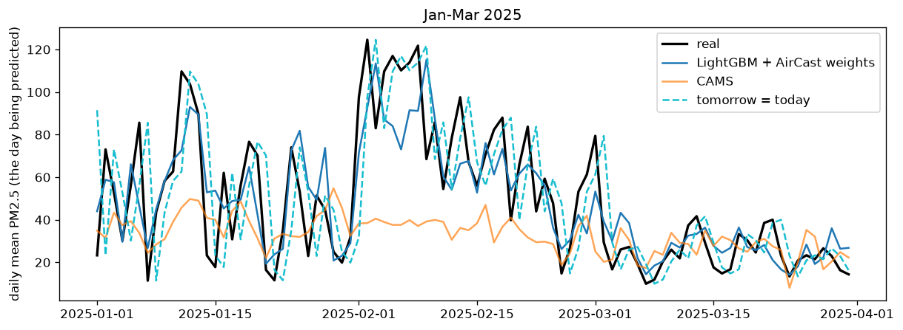
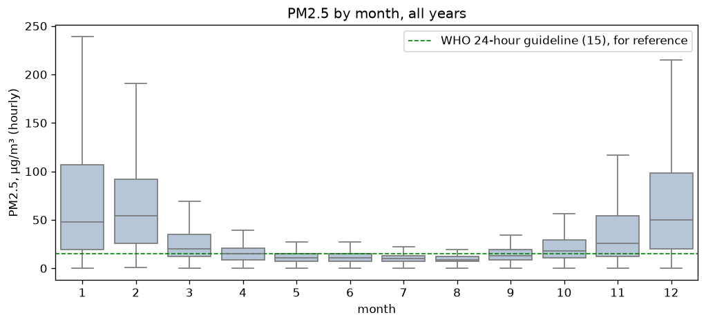
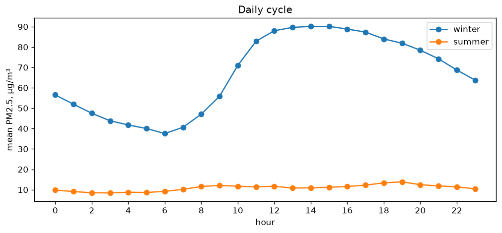
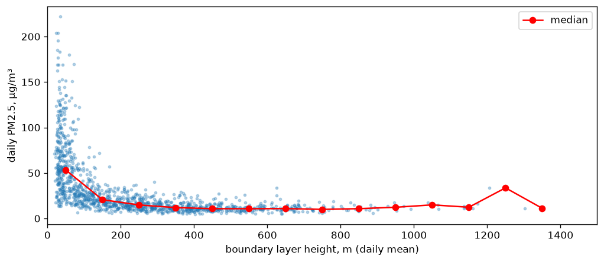
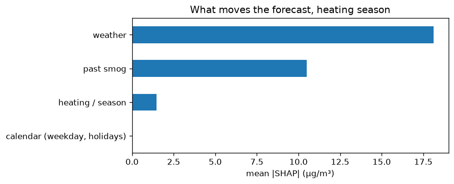
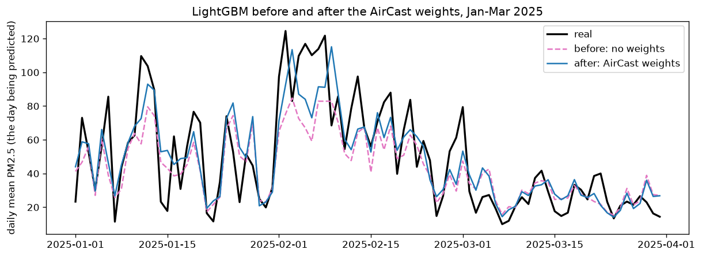
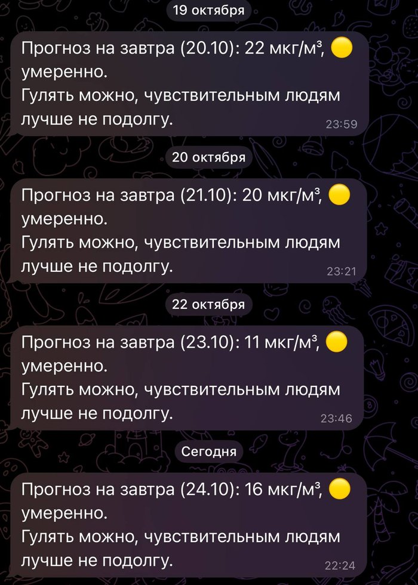

# Almaty Smogcast

This project predicts tomorrow's PM2.5 level in Almaty. The model was trained on high-quality data from the US station, but the station stopped working in November 2025, so I had to switch to lower-quality data from AirGradient sensors. On the 2025 test (with archived weather for tomorrow), the forecast was more accurate than CAMS. Every evening, my Telegram bot [@ala_smogfor_bot](https://t.me/ala_smogfor_bot) sends the forecast for tomorrow.



Test data, January-March 2025. CAMS is the least accurate. It catches some of the pattern, for example it goes up a little when the smog grows, but it strongly underestimates the high days. LightGBM follows the real line the most closely. "Tomorrow = today" is always one day late.

## Why

I live in Almaty, and the air gets really bad here in winter. I wanted to look at the data and understand why this happens and whether it gets better over time.

The city sits at the foot of the mountains. In winter, cold air can stay trapped near the ground. This is called a temperature inversion, and it makes it harder for pollution to escape. Coal heating also adds to the pollution.

CHP-2 is expected to switch from coal to gas by the end of 2026. I want to see whether this makes a difference to the air.

## Questions and short answers

1. **Can a simple model using local data predict tomorrow's PM2.5 better than the CAMS forecast?**
   Yes, much better. On 2025, a year the model never saw, its average error was 6.4 µg/m³, compared with 10.2 for CAMS. Probably because my model only looks at one city, while CAMS is a global model with big cells, so it can't see what happens in one valley near the mountains. CAMS catches the patterns, but it strongly underestimates the values.
2. **What matters most for smog: heating, traffic, or weather?**
   For my model, weather matters most. But there is no exact answer. Weather and heating are connected (when it's cold, people burn more coal), so a tree model can split the credit between them differently. And I had no real traffic data.
3. **After CHP-2 switches to gas, does pollution go down because of the switch, or because the winter is warmer?**
   This is one of my main goals. In theory the switch should help, because coal makes more pollution than gas. The switch hasn't happened yet, but the tracker is ready to measure it.

## Results

Test year 2025 (314 days, January to mid-November). The model never saw these days during training. MAE is the average error in µg/m³, lower is better.

| Forecast | MAE, all days | MAE, 10% most polluted days |
|---|---|---|
| CAMS (global forecast from Copernicus) | 10.19 | 48.43 |
| Linear regression | 9.55 | 23.28 |
| "Tomorrow = today" | 8.83 | 22.61 |
| LightGBM | 6.84 | 24.90 |
| LightGBM + AirCast weights | **6.39** | **19.48** |

- LightGBM's error is about a third lower than CAMS and about a quarter lower than "tomorrow = today".
- But on the most polluted days (above 58 µg/m³), plain LightGBM was worse than just saying "tomorrow = today". The weights fixed this (see below).
- CAMS misses the worst days by almost 50 µg/m³. From December to February it predicted about 34 µg/m³ on average, while the real average was 61.
- After the US station stopped, I also checked the models on AirGradient days (December 2025 to October 2026, 299 days): 6.34 for LightGBM with weights, 7.15 for "tomorrow = today" and 11.24 for CAMS.

## How it works

**Data**

- PM2.5: the US Consulate monitor in Almaty (US State Department program), downloaded from OpenAQ. The original data comes from AirNow. I use September 2020 to 14 November 2025, when it stopped. In the code I call it "embassy".
- Weather: hourly historical data from Open-Meteo, including boundary layer height (BLH).
- CAMS PM2.5 forecasts from the Open-Meteo air quality API, from August 2022. I only compare with them, the model doesn't use them.
- After the station stopped: 7 AirGradient sensors within 1.6 km of it. I take their median, so one broken sensor has less effect, and scale it by 0.69 (see Limitations).

**Problems with the data**

- Many hours are missing, especially in 2021-2022. A day only counts if it has at least 18 hours of data.
- Before March 2024, Almaty was on UTC+6, then it switched to UTC+5. Open-Meteo uses UTC+5 for all years, but the embassy data used the old time, so pollution and weather were one hour out of sync. Now everything uses UTC+5.
- Open-Meteo has no BLH data for January through June 2024.

**The task**

At the end of each day (23:00), the model predicts the average PM2.5 for tomorrow. Everything it uses has to be known by midnight, except tomorrow's weather (see Limitations).

**Features (38)**

- past pollution: PM2.5 at 23:00 today, yesterday and the day before, today's mean and max, the last 7 days
- weather today and tomorrow: temperature, wind, humidity, pressure, rain, BLH, and also night-time BLH and wind, because inversions happen at night
- weather change: a big drop in temperature or a change in pressure often means a cold front, which can clean the air
- calendar: day of the week, holidays, heating season

**Models**

I compare three simple forecasts ("tomorrow = today", CAMS and linear regression) with LightGBM. I trained LightGBM with MAE as the loss, because smog has big spikes and squared error chases them too much.

**How I tested it**

| Part | Period | Days |
|---|---|---|
| train | September 2020 - 2023 | 765 |
| validation | 2024 | 344 |
| test | 2025 (until 12 November) | 314 |

- Train has only 765 days for more than 3 years, because many days in 2021-2022 had less than 18 hours of data.
- I split the data by time and didn't shuffle the days. Otherwise the model would see days from the future, and the results would look better than they really are.
- LightGBM settings: learning rate 0.03, 15 leaves per tree.
- Early stopping on validation chooses the number of trees. Then I trained the model again on train + validation with the same number of trees and tested it on 2025.

## What I found



Winter is about 6 times dirtier than summer. The worst months are December, January and February. Then the air gets better in March and turns bad again in November, when heating starts.



At first, I thought that the worst air would be in the evenings, but in winter the peak is around 12:00-16:00. The cleanest time is early morning, around 6:00. Nearby Clarity sensors show the same pattern. In summer, the air is clean all day and the line is almost flat. I don't know the reason yet. Maybe daytime winds carry polluted air from the lower parts of the city, but I haven't checked this. After I shared the project, researchers from Almaty Air Initiative told me that in their data since 2023 the daytime peak is typical only for the south of the city. In most of the city, especially in the more polluted areas, the peaks are in the morning and in the evening. So this pattern is only true for the area around the station.

This surprised me the most. Traffic jams in Almaty are usually from 17:00 to 20:00, when there are more cars, but the winter smog peaks at 12:00-16:00. There is also no difference in smog between weekdays and weekends. Near the station, cars don't seem to be the main reason for winter smog, but with data from one point I can't say this for the whole city.



BLH is something like a ceiling over the city. It depends on the temperature, the time of day and the weather. The lower it is, the more smog stays near the ground, and the worse it is for people. All 66 days above 100 µg/m³ had an average BLH below 90 m. Daily PM2.5 was most connected to temperature (correlation -0.65) and BLH (-0.51). Wind speed alone had almost no connection (0.03).

The 10 most polluted days (169-222 µg/m³) were all in December or January, with temperatures from -14 to -6 °C and BLH of only 24-72 m.



I used SHAP to see how the model uses the features. If I leave out past pollution, weather gives about 92% of the rest, heating and season about 7%, and weekdays and holidays almost 0%. This describes my model, not what causes the smog. Weather and heating are connected, because on colder days people burn more coal. I also had no real traffic data, so the low number doesn't mean cars have no effect.

## Polluted days: an idea from AirCast (MBZUAI)

The 10 biggest errors of my model were all in winter 2025, and every time the forecast was too low. Measured PM2.5 was around 80-125 µg/m³, while the model predicted 40-80. Very polluted days are rare, so to keep the average error low, the model pulled its forecasts toward normal days.

AirCast ([Nedungadi et al., 2025](https://arxiv.org/abs/2502.17919)), a paper from MBZUAI, had the same problem on a much bigger scale. They solved it by giving rare values more weight. I did a simpler version: I put the days into 10 µg/m³ bins by PM2.5 level and gave days from rare bins a bigger weight. Normal days get a weight of about 1, medium polluted days 1.1-1.2 and the rarest days 1.3-1.6.

I chose the strength of the weights on the validation year, not on the test year. With strong weights the test results looked better, but on validation the model started to predict about 12 µg/m³ too high.

| Test 2025, MAE | without weights | with weights |
|---|---|---|
| all days | 6.84 | 6.39 |
| winter (November-March) | 14.20 | 12.93 |
| summer (April-October) | 3.30 | 3.25 |
| 10% most polluted days | 24.90 | 19.48 |



The same months as the plot at the top, before the AirCast idea (dashed line) and after it (blue line). The difference is easiest to see in early February 2025. The real level was 100-125 µg/m³, the model without weights predicted about 60-85, and with weights about 70-115. But sometimes it now goes too high, for example 115 when the real level was 68.

Normal days didn't really change, but the most polluted days did. On validation the result was mixed: the winter error went up a little (12.36 to 12.60), because there the model was already predicting too high. There were only 32 very polluted days in the test, so I want to check this again this winter with the bot's forecasts. The Telegram bot uses the model with weights.

## CHP-2 tracker

I can't just compare the winters before and after the switch. One winter could be warmer, windier or have better air mixing. So I made a second model that only knows the weather and the calendar, with no past PM2.5. Trained on the coal years, it says how polluted a winter would be with that weather.

To see how wrong this model normally is, I left out one winter at a time, trained on the rest and predicted the hidden winter. For 5 of 6 winters, the average was off by about 10% or less. For 2020-21 it was off by 38%, and I still don't know why. So a 10% drop after the switch could easily be a model error, and even a bigger drop wouldn't prove on its own that it came from CHP-2. When the switch happens, I'll run `src/chp2_tracker.py` every week. Other cities that heat with coal could use the same idea.

## Telegram bot

I made the bot first of all for my dad. Sometimes the air in Almaty gets very dirty, and I wanted him to be able to plan his walks for the next day, without worrying that a walk, which is usually good for health, could hurt his lungs. Now not only my dad but also my relatives get a message every evening about how polluted the air will be tomorrow.

[@ala_smogfor_bot](https://t.me/ala_smogfor_bot) sends tomorrow's forecast every evening (planned for 22:00 Almaty time, but GitHub sometimes starts it a few hours later), in Russian, with the US EPA level and short advice. GitHub Actions downloads fresh AirGradient and weather data and makes the forecast. A small Flask server on PythonAnywhere sends it to everyone who pressed /start. Subscribers' chat IDs stay on the server, not on GitHub. The bot uses a real weather forecast for tomorrow, so it doesn't have the "perfect weather" advantage from the tests.



I also found a problem in the bot. The model's most important feature is PM2.5 at 23:00, but the bot runs at 22:00, so this value was always empty, and on the test year the error would grow from 6.39 to 8.72. Now the bot uses the last measured hour (usually 21:00), and the error stays at 6.34.

There is also a simple Streamlit demo (`streamlit run app.py`). For now it only runs on my computer.

## Limitations

- In the tests, tomorrow's weather comes from the archive, so it works like a perfect weather forecast. Real forecasts can be wrong. Without tomorrow's weather, the MAE goes from 6.84 to 7.11, still about 30% lower than CAMS.
- AirGradient sensors are less exact. They read about 1.45 times higher than the US station. Only one sensor had enough days together with the station (331 days, correlation 0.93), so the factor 0.69 comes from that one sensor, and I apply it to all seven.
- In clean months the bot predicts too high: on AirGradient days from April to October it was about 3-5 µg/m³ above the real level. One factor of 0.69 for all levels probably makes clean days too low. A formula with a shift (a + b × AirGradient) could work better, I want to test it.
- Almaty Air Initiative told me that raw AirGradient sensors usually read about 1.6 times higher than reference monitors. This is close to the 1.45 I found myself, but one factor for all days is too simple: the error depends on humidity. They suggested the [EPA correction](https://www.airgradient.com/blog/epa-correction-and-airgradient/), which I want to try next.
- I'm not fully sure where the US station is: OpenAQ puts it about 3 km from the consulate's address. I chose the AirGradient sensors around the OpenAQ point.
- The forecast is for one point in the center. But AirGradient sensors show that in winter the north of the city can be about twice as polluted as the south near the mountains.
- I have no real traffic data, only weekdays, weekends and holidays.
- The test is only one year, with 32 very polluted days, so small differences between the models could be luck.

## How this project is different

This project is not unique. When I started, I didn't know how many people had made air quality forecasts for Almaty, I only found out during the project. The main difference is the data: my model is trained on about 5 years of measurements from a reference-grade monitor (the US Consulate station), which is much more accurate than cheap sensors.

## Related work

- [AirCast (Nedungadi et al., 2025, MBZUAI)](https://arxiv.org/abs/2502.17919) forecasts air pollution for the Middle East and North Africa. In their tests, "tomorrow = today" was also better than raw CAMS. I found this paper after I started my project and borrowed one idea from it: more weight for rare polluted days.

- [Kerimray et al. (2020)](https://doi.org/10.4209/aaqr.2019.09.0464) studied Almaty's monitoring stations for 2013-2018. PM2.5 is highest in winter, mostly because of coal burning for heating, with weak wind and temperature inversions making it worse. PM2.5 was also higher in the lower parts of the city. I saw the same thing in the AirGradient sensors: in winter the north (lower) was about twice as polluted as the south near the mountains.

- [Tursumbayeva et al. (2022)](https://doi.org/10.4209/aaqr.210294) used one year of weather balloon data. In winter the boundary layer was about 393 m and PM2.5 about 94 µg/m³, in summer about 1970 m and 9.9 µg/m³. The most polluted days had a shallow boundary layer, calm wind and weak ventilation. This is why BLH is one of the strongest features in my model. I also tried BLH × wind as a feature, but the validation error got worse (9.03 → 9.63), so I didn't add it.

## What I learned

In my flappy-bird project I wrote a neural network from scratch, and the game made all the data for me. This project was very different.

- I learned a new kind of model: decision trees and LightGBM.
- I worked with real, messy data: missing hours, a time zone change, a station that stopped, and cheap sensors I had to calibrate.
- My model looked good on average, but on the worst days it was worse than "tomorrow = today". I only saw this because I checked the polluted days separately.

## Next steps

- Test the model with real weather forecasts instead of the archive.
- Save the bot's forecasts every day and check how good they really are this winter.
- Make forecasts for different districts using AirGradient sensors around the city.
- Compare my 0.69 factor with the corrected sensor data from Almaty Air Initiative (they offered access to their API).
- Run the CHP-2 tracker after the switch to gas.

## How to run

Create a virtual environment and install the dependencies:

```powershell
py -3.13 -m venv .venv
.venv\Scripts\activate
pip install -r requirements.txt
```

Get a free API key from OpenAQ. Copy `.env.example` to `.env` and add your key. Then:

```powershell
python src/download_weather.py
python src/download_cams.py
python src/download_openaq.py
python src/download_airgradient.py   # needs the embassy data from download_openaq.py
python src/build_dataset.py
python src/train.py                  # results/metrics.csv and the models
python src/try_weights.py            # compares different weight strengths
streamlit run app.py                 # demo
```

The notebooks have the plots and the analysis: `01_eda` (data), `02_errors` (biggest errors), `03_shap` (SHAP), `04_chp2` (CHP-2).

## Data sources

PM2.5 from the US State Department monitor (AirNow) and AirGradient sensors, both through [OpenAQ](https://openaq.org). Weather and CAMS forecasts from [Open-Meteo](https://open-meteo.com) (CC BY 4.0), CAMS data by the Copernicus Atmosphere Monitoring Service.

## Project log

I wrote down what I did and found every day in [notes.md](notes.md). Some numbers there are from the day I wrote them and changed later, when I added new data. The numbers in this README are the current ones.
